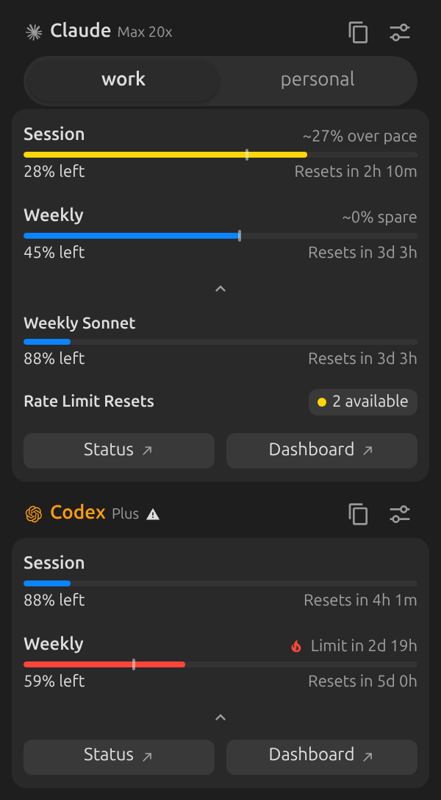

# Layout selector: mockup frames

Two frames for the issue that asks about a Layout selector in the tray
popover. Everything here is synthetic: no real account, usage figure or
credential was used.

| Default | Compact summary |
|---|---|
|  |  |

- `layout-default.png` is the popover built from `upstream/main` (`07fdf1e`).
- `layout-compact-summary.png` is the same report in a local build that has
  the compact visual. That build is not a pull request branch.
- The report is a fixture: two accounts of one provider and one account of
  another. One account has two banked rate-limit resets and one provider has
  an open status-page incident.
- Both are Classic, dark theme, 300 px wide at 2x, rendered in headless
  Chromium on Linux from the built `popover.js` / `popover.css`, with Ubuntu
  Sans standing in for Segoe UI. These are **not** native Windows or macOS
  captures.
- Both are cropped to the card area. The footer is left out because the local
  build's footer has controls that are not part of the proposal.
