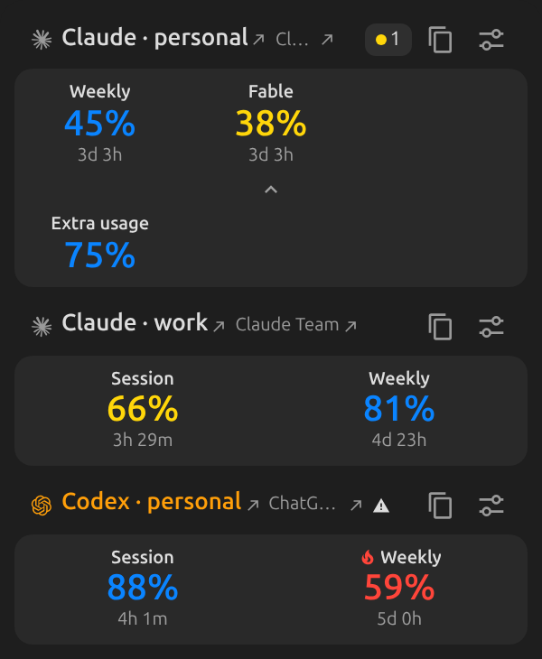

# Layout selector: mockup frames

Two frames for the issue that asks about a Layout selector in the tray
popover. Everything here is synthetic: no real account, usage figure or
credential was used.

| Default | Compact summary |
|---|---|
|  |  |

- `layout-default.png` is the popover built from `upstream/main` (`07fdf1e`).
- `layout-compact-summary.png` is the same report in a local build that has
  the compact visual. That build is not a pull request branch.
- `layout-selector.png` is the compact frame with the footer and the Layout
  menu open. It comes from the same local build with its menu cut to the two
  entries the issue proposes and named as in the issue; that build's own menu
  lists six local layouts.
- The report is a fixture: two accounts of one provider and one account of
  another. One account has one banked rate-limit reset and extra usage
  switched on, which is its third quota and so starts in the On Demand part
  of its card; one provider has an open status-page incident.
- The fixture has the shape of a real `usage --json` report: the labels
  (`Session (5h)`, `Weekly (7d)`, `Fable (7d)`, `Extra usage`, `Codex 5h`,
  `Codex weekly`) and
  the plan names are the ones the binary emits. The popover shortens the
  labels itself. Account names and figures are made up.
- Both are Classic, dark theme, 300 px wide at 2x, rendered in headless
  Chromium on Linux from the built `popover.js` / `popover.css`, with Ubuntu
  Sans standing in for Segoe UI. These are **not** native Windows or macOS
  captures.
- The first two are cropped to the card area. The footer is left out because the local
  build's footer has controls that are not part of the proposal.
