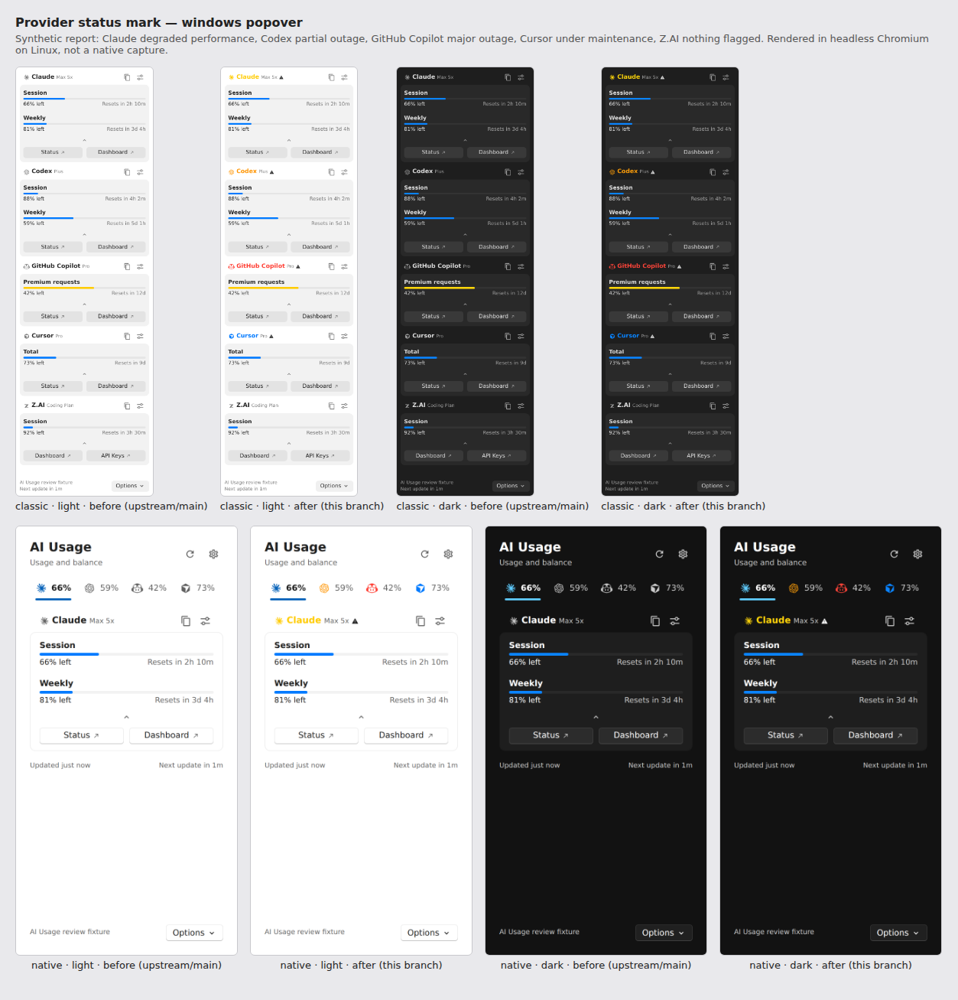
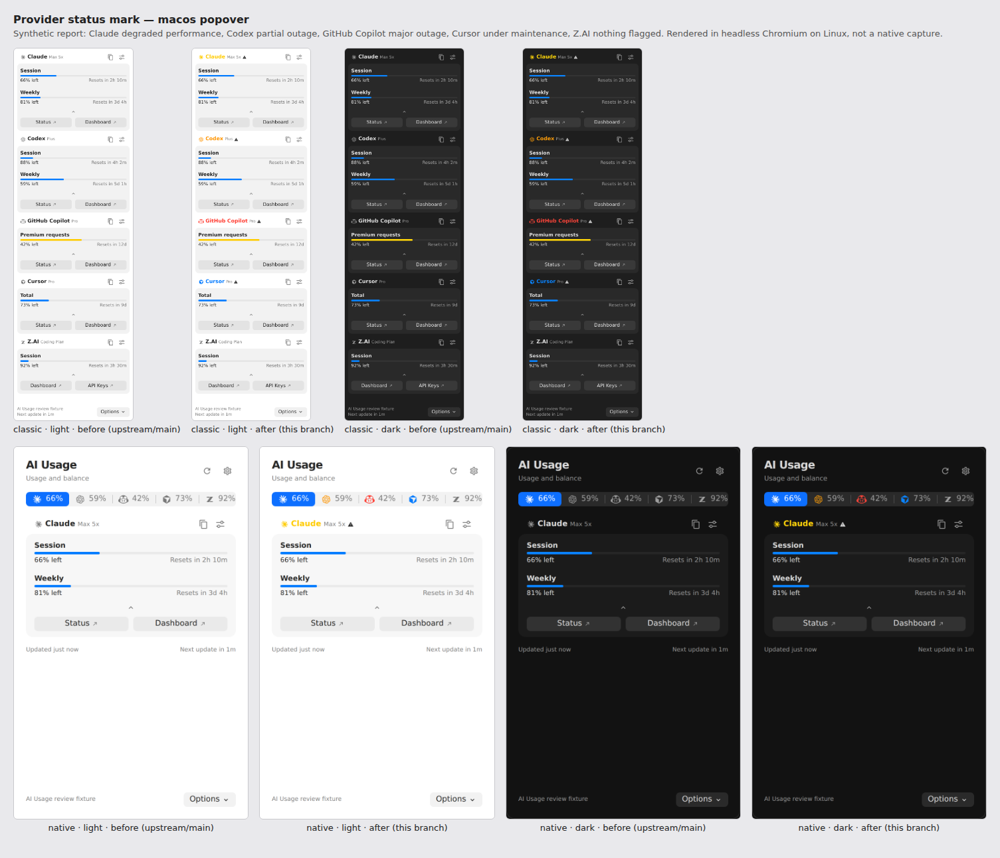
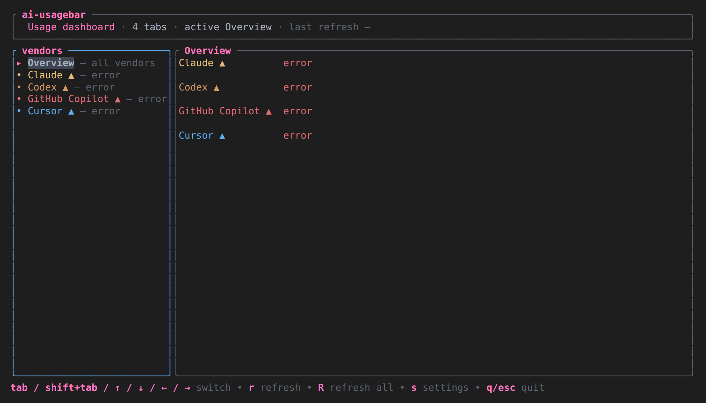
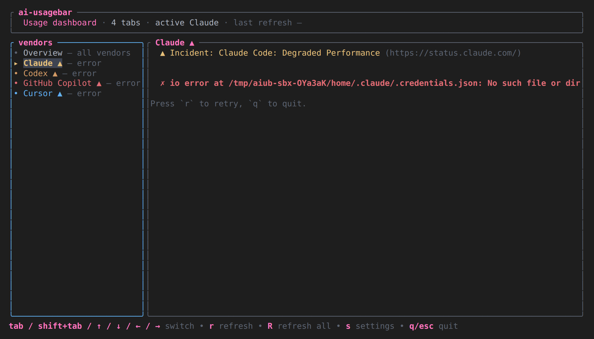

# Provider status mark: review evidence

Visual evidence for the pull request that colours a provider's name with its
status page. Everything here is synthetic: no real account, usage figure or
credential was used.

## Tray popover

- **Before** is the popover built from `upstream/main` (`7418f4c`, v1.51.0);
  **after** is the popover built from this branch. Both receive the same
  report.
- The report is a fixture: Claude with degraded performance, Codex with a
  partial outage, GitHub Copilot with a major outage, Cursor under
  maintenance, and Z.AI with nothing flagged.
- Rendered in headless Chromium on Linux from the built `popover.js` /
  `popover.css`. These are **not** native Windows or macOS captures.
- Single frames are named `<os>-<style>-<theme>-<before|after>.png`.

## TUI

- The branch's `ai-usagebar-tui`, run inside tmux under an empty sandbox
  profile. There are no credentials in it, which is why every provider reads
  `error`.
- The status pages were fetched for real, then the on-disk status cache was
  edited so that one matched component per page is abnormal (`Claude Code`
  degraded performance, `Login` partial outage, `Copilot` major outage, `IDE`
  under maintenance). The TUI then read that cache.
- The pane was captured as ANSI text and rendered to an image; the colours are
  the ones the TUI emitted with the default theme.
